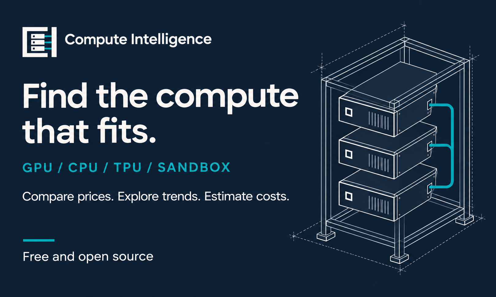
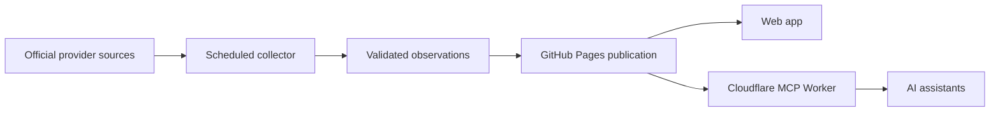

<p align="center">
  <picture>
    <source media="(prefers-color-scheme: dark)" srcset="client/public/brand/logo-white.svg">
    
  </picture>
</p>

<p align="center">
  Compare cloud compute with clear prices, configurations, sources, and observation times.
</p>

<p align="center">
  <a href="https://darkstarstrix.github.io/Compute_Intelligence/">Open the app</a> ·
  <a href="#connect-your-ai-assistant">Connect MCP</a> ·
  <a href="https://www.producthunt.com/posts/compute-intelligence">Product Hunt</a> ·
  <a href="CONTRIBUTING.md">Contribute</a>
</p>

<p align="center">
  <a href="https://github.com/DarkStarStrix/Compute_Intelligence/releases/latest"></a>
  <a href="LICENSE"></a>
  <a href="https://github.com/DarkStarStrix/Compute_Intelligence/actions/workflows/pages.yml"></a>
</p>

<p align="center">
  <a href="https://www.producthunt.com/posts/compute-intelligence"></a>
</p>

<p align="center">
  
</p>

## Find compute that fits your workload

Compute Intelligence is a free, open-source app for comparing **GPU, CPU, TPU, and sandbox compute** across cloud providers. It collects public provider data and brings pricing, hardware, regions, billing models, and reported availability into one searchable view. No account is needed to browse the app or use the public MCP.

- **Search and filter:** narrow offers by compute type, provider, model, region, resources, billing, and reported stock.
- **Compare offers:** inspect configurations, per-unit rates, whole-node costs, and rental terms side by side. Share a link to your selection.
- **Estimate job costs:** enter resource count and runtime; whole-node GPU rentals round up to the number of nodes required.
- **Explore recorded trends:** inspect listing history and provider movement. Filter for prices that actually moved, including those that returned to their starting price.
- **Inspect the evidence:** follow source links, observation timestamps, provider profiles, and stale-data labels.
- **Use your AI assistant:** query the same published data through five read-only MCP tools.

Coverage includes providers such as RunPod, Lambda, CoreWeave, Nebius, Hot Aisle, Lium, Vultr, Hetzner, Google Cloud, Microsoft Azure, E2B, Daytona, Vercel, and Cloudflare. For current coverage, open **Providers** in the app. See [data sources and interpretation](docs/data-sources.md) for adapter-specific details.

## What a quote means

Trust depends on preserving what each source actually reports:

| Detail         | How it is handled                                                                                                             |
| -------------- | ----------------------------------------------------------------------------------------------------------------------------- |
| Billing units  | GPU, instance, TPU chip, and sandbox rates retain their stated units. Spot and on-demand quotes stay distinct.                |
| Configurations | Known node size, VRAM, vCPU, RAM, and rental terms are shown. Missing specifications stay unknown.                            |
| Availability   | A published price does not establish stock. Unknown availability links back to the provider for confirmation.                 |
| Freshness      | Failed sources retain their previous quotes and original timestamps. Failed-source or over-two-hour quotes are stale.         |
| History        | Charts use recorded observations. Flat rates stay flat; missing intervals do not become invented price movements.             |
| Rankings       | Observed price ordering does not receive commercial weighting. Equivalent specifications do not prove equivalent performance. |

Collection is scheduled roughly every 15 minutes through GitHub Actions, with a Cloudflare dispatch backup. Scheduling and publication can be delayed. The app checks for a newer snapshot every minute and when you return to the tab. MCP uses the latest published snapshot; it does not probe providers on demand.

Prices are indicative, not reservations or guarantees of capacity. Confirm stock and final charges with the provider. Cost estimates may exclude taxes, storage, network fees, plan charges, and billing increments not represented in the source.

## Connect your AI assistant

Add this URL to a client that supports **remote MCP over Streamable HTTP**:

```text
https://compute-intelligence-mcp.allanw-mk.workers.dev/mcp
```

No API key is required. The service is public, read-only, and rate limited; do not send secrets or private workload details.

| Tool                | Purpose                                                                                                 |
| ------------------- | ------------------------------------------------------------------------------------------------------- |
| `search_compute`    | Filter listings by compute type and requirements; inspect applied filters and empty-result diagnostics. |
| `get_offer`         | Retrieve an exact listing with configuration, price, source, stock, and freshness.                      |
| `compare_offers`    | Compare 2–5 listings and explain incompatible units, models, specifications, billing, or quote state.   |
| `estimate_job_cost` | Estimate resource count × runtime while preserving whole-node and minimum-rental requirements.          |
| `get_price_history` | Retrieve real sampled observations and range statistics for an exact listing.                           |

Try asking:

> Find on-demand H100 SXM listings with at least 80 GB VRAM. Compare three offers, explain their stock and rental terms, estimate six hours for nine GPUs, and show their recorded price history.

Search never silently relaxes requirements. Empty results describe the published catalog, not the entire market. The MCP selects a lowest comparable unit quote only when its compatibility checks pass; it does not promise equal performance or the lowest complete job bill.

See the [MCP quick start](mcp/USAGE.md), [troubleshooting](mcp/TROUBLESHOOTING.md), [MCP architecture guide](mcp/README.md), [trust and security review](mcp/SECURITY.md), and [verification evidence](mcp/VERIFICATION.md) for contracts and limitations.

## Run locally

Requires **Node.js 22.12+** and **pnpm 10.4.1**.

```sh
git clone https://github.com/DarkStarStrix/Compute_Intelligence.git
cd Compute_Intelligence
pnpm install --frozen-lockfile
pnpm dev
```

The committed snapshot lets you develop without provider credentials or a cloud account. Use the local URL printed by Vite.

```sh
pnpm check             # TypeScript
pnpm test              # Offline regression suite
pnpm build:pages       # Build for /Compute_Intelligence/
pnpm dev:mcp           # Local MCP at http://127.0.0.1:8791/mcp
pnpm smoke:mcp         # Exercise all five tools against the local MCP
```

The local MCP reads the live published feed and requires network access. `pnpm collect` contacts configured public sources and rewrites the committed snapshot; it is not needed for routine UI development. `pnpm build` targets a root URL, while `pnpm build:pages` targets GitHub Pages.

## Architecture and deployment



The collector owns provider I/O and durable observations. The website and MCP reuse shared schemas, listing conversion, freshness rules, and cost calculations. MCP catalog and history reads must refer to the same publication; inconsistent or unavailable data produces an explicit error.

| Component                                      | Location                                          |
| ---------------------------------------------- | ------------------------------------------------- |
| React app and static assets                    | [`client/`](client/)                              |
| Shared data, pricing, and validation contracts | [`shared/`](shared/)                              |
| Collector, adapters, fixtures, and tests       | [`scripts/`](scripts/)                            |
| Public MCP Worker and tool contracts           | [`mcp/`](mcp/)                                    |
| Collector dispatch backup                      | [`refresh/`](refresh/)                            |
| Optional notification and analytics services   | [`alerts/`](alerts/) · [`analytics/`](analytics/) |

The website runs on **GitHub Pages**; the public MCP runs on **Cloudflare Workers**. There is no separate always-on provider server or database required for browsing or MCP queries. Optional watchlists and private analytics have separate service requirements.

See the [documentation index](docs/README.md), [operations and deployment](docs/operations.md), and [architecture contracts](ARCHITECTURE.md).

## Contribute a provider or improvement

Start with [CONTRIBUTING.md](CONTRIBUTING.md). Provider onboarding has a [standardized data-only PR template](.github/PULL_REQUEST_TEMPLATE/provider.md), a [submission format](provider-submissions/README.md), and a [maintainer integration guide](docs/provider-onboarding.md). A submission does not modify the backend collector; maintainers implement and review the integration separately.

[Request a provider](https://github.com/DarkStarStrix/Compute_Intelligence/issues/new?template=provider.yml) or [report an issue](https://github.com/DarkStarStrix/Compute_Intelligence/issues). Do not include credentials, private account data, or usable exploit details in public reports. See the [security reporting policy](SECURITY.md) and [MCP security boundaries](mcp/SECURITY.md).

## Support the project

Compute Intelligence remains free to use. Optional provider referrals and sponsorships help support maintenance. Referral links are disclosed; commercial relationships do not influence price ordering or technical acceptance of providers. RunPod referrals currently provide compute credits, subject to its eligibility rules.

Interested in sponsoring development? Use the [sponsorship inquiry](https://github.com/DarkStarStrix/Compute_Intelligence/issues/new?template=sponsorship.yml). See [support and monetization](docs/monetization.md) for configuration and disclosure rules.

## Built with

<p align="center">
  
  
  
  
  
</p>

[MIT licensed](LICENSE). Provider trademarks belong to their respective owners; their inclusion does not imply endorsement.
